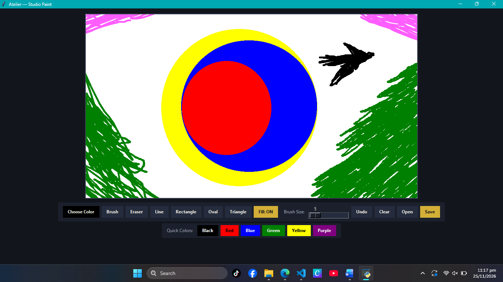

# Atelier — Studio Paint

A desktop Paint application built with Python, **Tkinter**, and **Pillow (PIL)** featuring a custom dark studio interface, live shape previewing, undo history, and image import/export.

## Setup & Run

1. Open your project folder in **Visual Studio Code**.
2. Open the terminal (<kbd>Ctrl</kbd> + <kbd>`</kbd>) and install Pillow:

```bash
python -m pip install pillow
```

3. Run the application:

```bash
python paint_application.py
```

## REQUIREMENTS COMPLETED

1. **Bigger brush range (5 points):**
   So, what I did here, ma'am, was change the brush size slider range from `1` to `30` up to `1` to `100` so I can draw with much thicker strokes. I also added a helper function (`draw_pillow_stroke`) that adds rounded caps to the Pillow lines so that when I save the drawing, the size and smooth look match what's on the Tkinter canvas.

2. **Undo button (15 points):**
   For the Undo feature, ma'am, I made an `undo_stack` list that saves a snapshot of the canvas right before I start drawing, clearing, or opening an image. Whenever I click the **Undo** button, it simply pops the last saved snapshot and brings it back—so whether it was a freehand brush stroke or a shape, it removes my latest action cleanly.

3. **Filled shapes (20 points):**
   Here, ma'am, I added a **Fill: OFF / ON** toggle button so I can switch between outline-only shapes and solid filled shapes. When it's toggled ON, both the live preview while dragging and the final shape saved on the Pillow image get filled with whatever color I currently have selected.

4. **Extra shape tool (20 points):**
   Aside from Line, Rectangle, and Oval, ma'am, I added a **Triangle** tool. I calculated the three corner points based on where I drag the mouse so it shows a live triangle preview as I drag, and once I release the mouse button, it saves the triangle directly onto the Pillow image.

5. **Confirm before clearing (20 points):**
   To avoid accidentally deleting my drawing, ma'am, I updated the `clear_canvas()` function to pop up a confirmation box using `messagebox.askyesno()` with **Yes** and **No** buttons. It only wipes the canvas clean if I click **Yes**.

6. **Quick colors (20 points):**
   Instead of always opening the full color picker, ma'am, I added a Quick Colors bar right below the main toolbar with six one-click buttons: **Black**, **Red**, **Blue**, **Green**, **Yellow**, and **Purple**. Clicking any of them immediately switches my active color (and automatically switches back to the brush if I was using the eraser).

7. **Screenshot of the whole UI design:**



